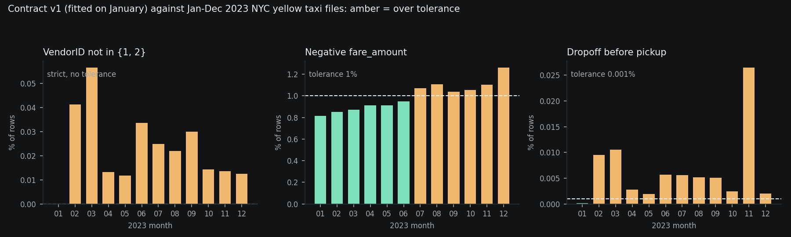

# Data contracts platform

[](https://github.com/VasilenData/data-contracts-platform/actions/workflows/ci.yml)

A small tool for the promise a data producer makes to its consumers. You write the promise as a YAML contract, check a file against it, and compare two versions of the contract to see whether a change would break a consumer.

- **Validate**: schema, nulls, uniqueness, ranges, allowed values, regex, row count, freshness and cross-column SQL checks, all counted in one DuckDB scan, with tolerances and sample bad rows.
- **Diff**: classifies every change between two contract versions as breaking, review or safe, and fails if the version number was not bumped enough (semver).
- **CLI**: `validate` and `diff` with exit codes (0 pass, 1 violations or breaking, 2 bad input) so it can gate a pipeline.

## Result on real data

I wrote `contracts/yellow_taxi_v1.yaml` by profiling **January 2023** of the public NYC TLC yellow taxi files (3,066,766 rows), then ran it unchanged on all 12 months of 2023 (the January file is the only one the contract was fitted on, so the other 11 are out-of-sample).



| Month | Rows | Result | passenger_count, RatecodeID type | VendorID not 1 or 2 | Negative fare | Dropoff before pickup |
|---|---|---|---|---|---|---|
| 2023-01 | 3,066,766 | pass | ok | 0 | 0.817% | 0.0001% |
| 2023-02 | 2,913,955 | FAIL | double to int | 0.041% | 0.850% | 0.0095% |
| 2023-03 | 3,403,766 | FAIL | double to int | 0.057% | 0.872% | 0.0105% |
| 2023-04 | 3,288,250 | FAIL | double to int | 0.013% | 0.912% | 0.0028% |
| 2023-05 | 3,513,649 | FAIL | double to int | 0.012% | 0.914% | 0.0019% |
| 2023-06 | 3,307,234 | FAIL | double to int | 0.034% | 0.951% | 0.0057% |
| 2023-07 | 2,907,108 | FAIL | double to int | 0.025% | 1.072% | 0.0056% |
| 2023-08 | 2,824,209 | FAIL | double to int | 0.022% | 1.109% | 0.0052% |
| 2023-09 | 2,846,722 | FAIL | double to int | 0.030% | 1.039% | 0.0051% |
| 2023-10 | 3,522,285 | FAIL | double to int | 0.014% | 1.053% | 0.0024% |
| 2023-11 | 3,339,715 | FAIL | double to int | 0.014% | 1.104% | 0.0265% |
| 2023-12 | 3,376,567 | FAIL | double to int | 0.012% | 1.263% | 0.0020% |

What the real files showed:

- **Schema drift from February.** `passenger_count` and `RatecodeID` are stored as doubles in January and as integers in every later file. The contract pinned them as `float`, so the schema rule flags a deviation from that declared type. When a column fails its schema rule the validator skips that column's value rules, because comparing values of the wrong type would be noise.
- **A new vendor code.** `VendorID` 6 first appears in February (1,201 rows) and keeps appearing every month. The contract allows only 1 and 2 with no tolerance, so it fails every month after January.
- **Negative fares crept over the tolerance.** January has 0.817% negative fares and I set a 1% tolerance. From July the rate is above 1% in every month (1.04% to 1.26%).
- **Dropoff before pickup** is 3 rows in January (about 0.0001%) and 67 to 885 rows later, over the 0.001% tolerance every month.

The row counts for each rule match an independent hand profile of January (88 trips over 100 miles, 20 with more than 6 passengers, 25,049 negative fares, 13,106 `RatecodeID` values outside 1 to 6, 225 negative tips, 3 dropoffs before pickup). Raw results: `measurements/real_months.json`.

### Contract versions

`datacontracts diff` between the shipped examples:

```
$ datacontracts diff contracts/yellow_taxi_v1.yaml contracts/yellow_taxi_v2.yaml
  SAFE     column congestion_surcharge: added (float)
  SAFE     column airport_fee: added (float)
  SAFE     column fare_amount: max tightened: 500 -> 400
needs a minor bump; version ok

$ datacontracts diff contracts/yellow_taxi_v1.yaml contracts/yellow_taxi_v3_breaking.yaml
  BREAKING column tip_amount: removed
  BREAKING column passenger_count: type changed: float -> int
  BREAKING column passenger_count: max widened: 6 -> 9
  BREAKING column VendorID: now nullable (was NOT NULL)
  BREAKING column VendorID: new allowed values consumers may not handle: [6]
  BREAKING min_rows: lowered: 1000000 -> 500000
  BREAKING check total_covers_fare: removed
  BREAKING check pickup_in_2023: removed
needs a major bump; VERSION TOO LOW: breaking changes need a major version bump
```

CI runs both: v1 to v2 must pass and v1 to v3 must be rejected.

## Quick start

```bash
pip install .            # or: pip install -r requirements.txt and run with PYTHONPATH=src
datacontracts validate contracts/yellow_taxi_v1.yaml yellow_tripdata_2023-01.parquet
datacontracts validate contracts/yellow_taxi_v1.yaml data.csv --json
datacontracts validate contracts/yellow_taxi_v1.yaml data.parquet --format github   # ::error per failed rule
datacontracts profile data.parquet --out contract.yaml   # propose a first contract to review
datacontracts dbt-import models/schema.yml --model orders --out contract.yaml   # draft from dbt tests
datacontracts diff old_contract.yaml new_contract.yaml
```

Get the real files (about 50 MB each, not stored in this repo):
`https://d37ci6vzurychx.cloudfront.net/trip-data/yellow_tripdata_2023-01.parquet` (change the month). To reproduce the table and chart: `python scripts/measure.py DIR` then `python scripts/plot_drift.py`.

A contract looks like this:

```yaml
dataset: orders
version: 1.2.0
owner: data-platform@example.com
min_rows: 1000
freshness: {column: created_at, max_age_hours: 24}
columns:
  - {name: order_id, type: int, nullable: false, unique: true}
  - {name: amount, type: float, min: 0, max: 100000, max_violation_rate: 0.001}
  - {name: status, type: string, allowed: [paid, refunded]}
checks:
  - {name: refund_not_above_amount, expr: "refund <= amount", severity: warn}
```

## How it works

- `spec.py` validates YAML before execution: unknown types, duplicate columns, malformed semver, quoted boolean flags, invalid row floors, and non-finite/out-of-range tolerances are rejected. Freshness requires a date/timestamp column and a finite non-negative age limit.
- `validate.py` turns every rule into a SQL predicate that is TRUE for a violating row, and computes the row count and every violation count in a single `SELECT`. Nulls never trip a range, allowed-values or regex rule (use `nullable: false` for that), and a cross-column check that evaluates to NULL is not a violation.
- `diff.py` treats the contract as a promise. Weakening it is breaking (a removed column, a wider range, a new allowed value, a nullable column that was NOT NULL, a looser tolerance, a removed check). Strengthening it is safe. Regex and owner changes are flagged for review.

Freshness accepts naive UTC or timezone-aware clocks and normalizes aware values to UTC. A DATE source is measured from midnight UTC. Missing or mistyped freshness columns produce schema failures instead of crashing the query. An empty allowed-values list permits only nulls; combine it with `nullable: false` when no value should pass. Validator-created DuckDB connections are closed after each call; caller-owned connections remain open.

## Failures as GitHub annotations

`--format github` prints one workflow command per failed rule, then the usual text summary. In a GitHub Actions step, each one shows up on the contract file in the run summary, on the line that defines the rule:

```yaml
- run: datacontracts validate contracts/orders.yaml data/orders.parquet --format github
```

Real output for March 2023 against the January contract (`measurements/github_annotations_2023-03.txt`), first line:

```
::error file=contracts/yellow_taxi_v1.yaml,line=10,title=allowed%3AVendorID::1,928 violations of 3,403,766 rows (0.0566%25), allowed 0.0000%25. value not allowed
```

Custom check names must be non-empty and unique. Duplicate names are rejected before validation; direct Python contracts also keep each rule's severity independent of other rule names or ordering. Adding a warning cannot downgrade a blocking failure.

Rules with `severity: warn` become `::warning`. Sample rows are not printed, so values from the data do not end up in CI logs. Message text is escaped, so a check expression containing a newline cannot start a second command. The command syntax is from GitHub's workflow-commands documentation and the escaping is the same as `escapeData` and `escapeProperty` in the `actions/toolkit` source. CI runs it on a deliberately failing sample (`contracts/demo_orders.yaml`) so the annotations show on the run summary; that step tolerates exit code 1 and fails on anything else. The summary showed `allowed:status: contracts/demo_orders.yaml#L10` with the message, so the line numbers and the escaping render as intended. The demo's red annotations on a green run are intentional. Limits: line numbers come from a text match on `name:` in the YAML, so a contract that defines the same column name twice would point at the first match.

## Propose a first contract

`datacontracts profile FILE` reads a parquet or csv file and prints a contract to start from. It is a draft to review, not a finished contract. The rules, all computed from the file:

- **Types and nulls:** the type of every column, and `nullable: false` only if the file has no nulls.
- **Bounds:** `min` and `max` from the 0.1st and 99.9th percentiles, widened outward onto a tidy step.
- **Allowed values:** a list for columns with at most 12 distinct values. A value under 0.1% of rows is left out, so a new code is flagged. A column with an allowed list gets no separate bounds.
- **Unique:** only for int or string columns that are unique across at least 100 rows.
- **Row floor:** `min_rows` is half the profiled row count.
- **Tolerance:** each column's `max_violation_rate` is the exact share of profiled rows outside its proposed rules, times `--headroom` (default 2, minimum 1), rounded up. So the proposal passes on its own file, and the command checks that before it prints anything.

Not proposed: freshness, regex and cross-column checks, because they depend on how the data is produced. The contract format cannot cap a column's null rate, so a column with nulls is only marked nullable.

**How good is the proposal?** I profiled January 2023 (3.07M rows, 4.22 s) and judged all 12 months, the same test as the hand-written v1 contract (`scripts/profile_vs_handwritten.py`, `measurements/profile_vs_handwritten.json`; the headroom 2 proposal itself is `measurements/auto_contract_2023-01.yaml`). I predicted before running it that at least 10 of the 11 later months would fail. All 11 did.

| Contract | Rules | Rules failing per month, Feb to Dec | Failing in both the proposal and v1 |
|---|---:|---|---|
| Hand-written v1 | 29 | 4 to 5 | n/a |
| Proposed, headroom 1 | 44 | 10 to 14 | 3 to 4 |
| Proposed, headroom 2 (default) | 44 | 5 to 6 | 3 to 4 |

My first version used headroom 1, which makes each tolerance equal to January's own rate, so any ordinary month-to-month wobble tripped it. In February, `max:extra` was 0.082% against 0.078% allowed. Adding headroom more than halved the failures. The default of 2 is my choice and I tuned it after seeing these 12 months, so treat the headroom 2 row as fitted to this data. The proposal still lacks what I wrote by hand: it has no `dropoff_not_before_pickup` check, its `min:fare_amount` never fires in a month where mine does, and it flags `max:extra`, `max:congestion_surcharge` and `schema:airport_fee`, which I have not judged to be real problems. The three rules that fail in both contracts each month are the ones I would call real drift. Read the output, delete rules you do not believe and add the cross-column checks yourself.

## Import a contract from dbt

`datacontracts dbt-import schema.yml --model NAME` drafts a contract from a dbt model's column types and tests, so a team that already writes dbt tests does not start from a blank file. Only tests that mean the same thing as a contract rule are imported. Everything else is skipped and listed in comments at the top of the output, never guessed.

| dbt | Contract |
|---|---|
| `data_type` | the column `type` (varchar, integer, double, numeric(10,2), timestamp_ntz and similar) |
| `not_null`, `unique` | `nullable: false`, `unique: true` |
| `accepted_values` | `allowed` |
| `accepted_range` (dbt_utils) | `min` and `max`. A strict range (`inclusive: false`) is imported as inclusive and noted, which is slightly weaker |
| model-contract constraints `not_null`, `unique`, `primary_key` | the same rules |
| `relationships`, other tests, model-level tests, `where` filters, `severity: warn`, `error_if` and `warn_if` | skipped and listed |

It reads both `data_tests` and the older `tests` key, and both the `arguments:` form and flat arguments. A `where: col is not null` filter is imported, because the validator already ignores nulls in `allowed` and `unique`. A column without a `data_type` is skipped, or typed from a file with `--source FILE`. With several models in the file, `--model` is required. I checked the null behavior against the sources of dbt's `unique`, `not_null` and `accepted_values` tests and dbt_utils' `accepted_range`.

Differences to keep in mind: dbt reports failing groups and the validator counts failing rows, a contract has one severity per column, and `relationships` needs a join across two tables that a one-file validator cannot do.

**Tried on a real schema file.** I imported the `fct_trips` model from my NYC Taxi platform's own `schema.yml` (copied unchanged to `contracts/dbt_example/`): 11 tests found, 9 imported, the 2 `relationships` skipped, and 20 columns typed. The result is `measurements/dbt_import_taxi_fct_trips.yaml`. I predicted before running that it would pass all 12 months of 2023 and catch injected defects. It passed all 12 months (2.7M to 3.4M rows each, 13 rules, 0.04 to 0.07 s per month), but it caught only 3 of the 4 defect types I injected into January: 100 null `pickup_at`, 50 `pickup_hour` of 25 and 50 negative distances were flagged, and 50 duplicated `trip_id` values were not. The schema file has `not_null` but no `unique` test on `trip_id`, so the import faithfully carries that gap into the contract. An imported contract is as strong as the dbt tests behind it. Two caveats: the warehouse of that project is not shipped, so `scripts/dbt_import_on_taxi.py` rebuilds `fct_trips` in plain DuckDB from the same SQL (same rules and variables). It is not produced by `dbt run`. And passing every month says the data meets its dbt tests, not that nothing drifted; the January-fitted contracts above are what catch drift.

## Run it under Airflow

`airflow/dags/contract_check.py` validates the 12 monthly files, one mapped task per month, so a month that violates the contract fails independently and the other months still run. `src/datacontracts/orchestrate.py` holds the logic without any Airflow import, so it is unit tested directly.

- **Two kinds of failure, handled differently.** A missing file or I/O error may be transient, so the task retries 3 times with exponential backoff. A contract violation means the file does not meet the configured rules; retrying the same unchanged file will not resolve the violation. The task sends the alert and fails at once through `AirflowFailException`, with no retries. The rules or the source data need review; a failed check alone does not establish which one should change.
- **The alert says what broke.** One message per failed file, listing each blocking rule with its violation count, rate and allowed rate. It is always appended to a log file (`DATACONTRACTS_ALERT_LOG`) and also posted to a Slack-style webhook if `DATACONTRACTS_WEBHOOK` is set. A broken webhook is reported, not raised, so it cannot hide the original failure.

Measured with `airflow dags test` on Airflow 2.10.5 (`measurements/airflow_runs.json`, `measurements/airflow_alerts_real_data.log`):

| Run | Result |
|---|---|
| Real 2023 files, contract v1 | January passed, the other 11 months failed, 11 alerts, 0 retries |
| Data folder missing (retry delay set to 1 s) | 36 retry attempts (12 tasks x 3), 12 tasks failed after retries, 12 alerts |

To run it: `pip install apache-airflow==2.10.5` with the official constraints file, then `PYTHONPATH=src DATACONTRACTS_DATA_DIR=<folder> airflow dags test contract_check 2026-11-08`. This is a local run for a demonstration. It is not deployed, the DAG has `schedule=None`, and I did not run a long-lived scheduler or webserver.

## Tests

225 tests (212 for the validator, diff, CLI, annotations, profile and dbt import, 12 for the orchestration helpers, and 1 DAG import and retry-policy test that runs in its own CI job with Airflow installed), run on every push with ruff. The validator tests inject an exact number of each violation into synthetic data and assert that exact count (for example 7 values below the minimum, 4 disallowed statuses, 2 duplicate ids). Boundary tests confirm that a value equal to a min or max, and a table exactly at the freshness limit, pass. I also broke the code on purpose to check that the tests notice: flipping `<` to `<=` on a bound, `>` to `>=` on the freshness limit, inverting the allowed-values test, dropping the duplicate count and zeroing the row-count shortfall each made at least one test fail. Two of those survived my first draft of the tests, and I added the boundary tests to kill them. The annotation module was mutation-checked with 8 mutants (inverted severity, broken escaping, off-by-one line numbers, passing rules reported, missing-line handling and the block-style YAML match); one survived until I added a block-style YAML test. The profile module was checked with 18 mutants (the thresholds and their boundaries, the widening direction, the rounding, the headroom and its guard, the redundant-bounds rule and the tolerance arithmetic); the first pass left two alive, one a real gap (values exactly on the lower bound) and one equivalent code that I removed. The dbt import was checked with 25 mutants (the rule mappings, the range bounds and their guards, the null-guard `where` rule, the severity and threshold filters, the legacy `tests` key, the model choice, the owner precedence, the type mapping and the imported-test count); five survived the first 71 tests, and four new tests killed them. Writing the profile tests also exposed a bug in my own test loader, which silently dropped the first row of every file. The orchestration helpers got the same treatment with 7 mutants (inverting the warning filter, the truncation limit, the missing-file check, the pass check, the log write and the webhook error handling), and one survived until I added a test for exactly five failures.

## Decisions and trade-offs

- **DuckDB, not a Python row loop.** The rules are SQL predicates, so a few million rows validate in under a second and the engine reads parquet and CSV directly.
- **One scan for all rules, and where it helps.** On the 3.07M-row January parquet file, one query per rule was faster than my single scan (0.566 s against 0.78 s, median of 5 interleaved runs, a speedup of 0.73x, so a slowdown). On a 500,000-row CSV sample of the same file (median of 5 interleaved runs) it reversed: 0.275 s against 3.374 s, about 12x faster, because each separate query has to parse the CSV again. I kept the single scan because it gives consistent counts from one pass and it wins by a wide margin on CSV, and I did not claim it is faster in general.
- **Tolerances per rule.** Real data is never clean. A strict zero-violation default plus an explicit `max_violation_rate` makes the accepted mess visible in the contract instead of hidden in code.
- **Schema failure skips value rules for that column.** It avoids a flood of follow-on failures, at the cost that a drifted column is not value-checked until the contract or the source is fixed.
- **Contract diff is rule-based, not data-based.** It only needs the two YAML files, so it can run in a pull request without access to the data.

## Limits

- The contract was fitted on one month and judged on later months, so the failures show where January was not representative of the year, not that the TLC data is bad. The thresholds are my choices.
- Throughput is reported only as the comparison above. Per-month timings in `real_months.json` ran on a shared one-core sandbox and varied between about 0.2 s and 0.8 s for similar files, and months where a column fails its schema rule evaluate fewer rules, so they are not comparable with each other.
- Checks are SQL expressions, which are trusted input. Do not load contracts from untrusted sources.
- `diff` compares contract files only. It does not know which consumers read which column, so "breaking" means "could break a consumer", not "will".
- Types are coarse (string, int, float, bool, date, timestamp). There is no decimal precision or nested type support.
- Local files only. The Airflow DAG runs locally through `airflow dags test`. It is not deployed, not scheduled, and not wired to a warehouse or a catalog.

## Next steps

- Import `relationships` as a cross-file check, which needs a second input file.
- Read dbt `unit_tests` and `sources` freshness into a contract.

MIT licensed. Data: NYC Taxi and Limousine Commission trip records (public).
